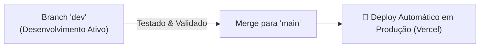

# 🤖 AGENT.md — Guia do Desenvolvedor & Agentes de IA

Este documento descreve a arquitetura, o fluxo de desenvolvimento e as diretrizes de contribuição para o repositório **Muamba Search**. Qualquer desenvolvedor ou agente autônomo (Antigravity, Cursor, Copilot, etc.) deve seguir rigorosamente as regras aqui estabelecidas.

---

## 1. 📌 Visão Geral do Projeto

O **Muamba Search** é um scanner e analisador de oportunidades dos leilões da Receita Federal do Brasil ([Sistema de Leilão Eletrônico - SLE Sociedade](https://www25.receita.fazenda.gov.br/sle-sociedade/portal)), projetado para identificar itens de alta liquidez e margem para revenda comercial.

### Stack Tecnológica
* **Frontend Web:** Next.js 15 (App Router), React 19, TypeScript, Tailwind CSS, Lucide Icons.
* **Hospedagem & Deploy:** Vercel (conectada diretamente à branch `main`).
* **Utilitário CLI & Dados:** Python 3.10+, Requests, Pydantic, Pandas, Openpyxl, Rich.
* **Testes & CI/CD:** Pytest, TypeScript Compiler (`tsc`), GitHub Actions.

---

## 2. 📁 Estrutura do Repositório

```text
muamba-search/
├── .github/
│   └── workflows/
│       └── ci.yml               # Pipeline de CI (Next.js Build, Typecheck e Pytest)
├── muamba/                      # Utilitário CLI em Python
│   ├── __init__.py
│   ├── cli.py                   # Ponto de entrada do CLI Python
│   ├── client.py                # Cliente HTTP para API pública da Receita
│   ├── exporter.py              # Exportador para Excel / CSV
│   └── models.py                # Modelos Pydantic (Edital, Lote, Item)
├── src/                         # Aplicação Web (Next.js)
│   ├── app/
│   │   ├── api/                 # Rotas de API Serverless
│   │   │   ├── editais/         # Listagem de editais abertos
│   │   │   ├── market-prices/   # Consulta de preços de mercado
│   │   │   └── search/          # Busca de lotes por palavra-chave
│   │   ├── layout.tsx           # Layout principal da aplicação
│   │   └── page.tsx             # Página inicial e busca interativa
│   ├── components/              # Componentes de UI (React)
│   │   ├── LoteCard.tsx         # Card de exibição do lote na listagem
│   │   ├── LoteModal.tsx        # Modal com fotos em alta resolução e detalhes
│   │   ├── MarketPricesSection.tsx # Estimativas de preço de mercado
│   │   ├── Navbar.tsx           # Barra de navegação
│   │   └── SearchFilters.tsx    # Filtros (PF/PJ, desconto, ordenação)
│   └── lib/                     # Utilitários e tipagens
│       ├── date-utils.ts        # Utilitários de formatação de datas
│       ├── product-identifier.ts# Identificação heurística de modelo/marca
│       ├── receita.ts           # Integração com API do SLE Receita Federal
│       └── types.ts             # Tipos TypeScript compartilhados
├── tests/                       # Testes automatizados do utilitário Python
│   └── test_muamba.py
├── package.json                 # Dependências Node.js e scripts
├── requirements.txt             # Dependências Python
└── tsconfig.json                # Configurações do compilador TypeScript
```

---

## 3. 🌿 Estratégia de Branches & Git Workflow

O repositório utiliza uma política estrita de **duas branches principais**:



### Regras Obrigatórias:
1. **Branch `main` = PRODUÇÃO:**
   * **NUNCA** codifique ou faça commits de trabalho em andamento diretamente na `main`.
   * Qualquer alteração na `main` dispara o deploy imediatamente para o site oficial.
2. **Branch `dev` = DESENVOLVIMENTO:**
   * Todo desenvolvimento, criação de componentes, novas APIs e correções de bugs ocorrem na branch `dev`.
   * A Vercel gera URLs de Preview automáticas para testar alterações feitas na branch `dev`.
3. **Padrão de Mensagens (Conventional Commits):**
   * Use o formato: `<tipo>(<escopo opcional>): <descrição no imperativo>`
   * Exemplos:
     * `feat(lotes): adicionar filtro de localização por estado`
     * `fix(receita): tratar timeout na consulta de fotos`
     * `ci(workflows): adicionar cache no build do nextjs`
     * `docs(readme): atualizar guia de instalação`

### Como promover código de `dev` para `main`:
Quando as funcionalidades estiverem testadas e prontas para entrar no site oficial:
```bash
git checkout main
git merge dev
git push origin main
git checkout dev
```

---

## 4. 🧪 Validação & Garantia de Qualidade

Antes de enviar qualquer alteração (`git push`), certifique-se de que todas as validações passam localmente:

### Comandos de Verificação:

1. **Checagem Estática de Tipos (TypeScript):**
   ```bash
   npm run typecheck
   ```
2. **Build de Produção (Next.js):**
   ```bash
   npm run build
   ```
3. **Testes Unitários Automatizados (Python):**
   ```bash
   python -m pytest
   ```

Se qualquer um desses comandos falhar, o push **NÃO** deve ser realizado até que o problema seja resolvido.

---

## 5. 🤖 Diretrizes Específicas para Agentes de IA

Ao atuar neste repositório, você deve:
* **Preservar a tipagem estrita:** Sempre defina interfaces e tipos claros em TypeScript. Evite `any` implícito ou explícito.
* **Componentes React Limpos:** Use Tailwind CSS de forma semântica, responsiva (mobile-first) e mantenha a consistência com o tema escuro/claro da aplicação.
* **Resiliência de Rede:** As APIs da Receita Federal podem responder lentamente ou apresentar indisponibilidades pontuais. Trate erros de requisição com fallbacks elegantes e mensagens amigáveis na interface.
* **Arquivos Ignorados:** Nunca tente versionar artefatos de build (`.next/`, `*.tsbuildinfo`, `dist/`), ambientes virtuais (`.venv/`) ou arquivos temporários de exportação (`*.xlsx`, `*.csv`).
